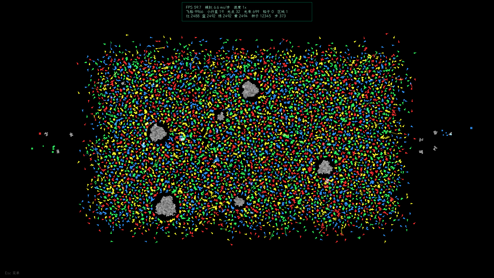

# 暗域光战 / Darkfield Lightwar

C++17 + SFML 2.6.2 的四人阵营太空沙盘。当前版本以 `versions/ver0.1.4.cpp` 的玩法为基准，**从零重写了底层架构**，目标是把「几百艘就卡」提升到「上万艘仍可跑」。

> **v2.2.0**：新增 `N` **创造面板**：飞船 / 小行星 / 机遇，投放 / 增援 / 传送门，
> 阵型、数量、初速、属性加点/等级随机分配、小行星大小与不规则度、机遇持续时间/范围/种类；
> 手动投放有范围预览和方向箭头（线条颜色跟随阵营）。传送门默认 1000 血（可改到 1,000,000），
> 固定无碰撞箱，1/3/5/10 分钟原地刷一波。新增 `K` **观察面板**，统合视野 / 等级 / 传送门信息 /
> 称号四个开关 + 全开/全关；称号实时显示（默认开，图集 1:1 绘制）。`V` / 右下角手柄可把地图等比缩小，
> 仍能看到全图。新增 `B` **沙盒面板**：0.25× / 1× / 4× / 9× 战场（800×450 到 4800×2700），
> `F11` 或面板切换窗口 / 全屏 / 无边框全屏（保留任务栏），全屏时按 16:9 等比缩放虚拟画面。
> 原面板统一改名“统计面板”。
> **v2.1.0**：删除旧 H 历史战绩，新增 `M`/`H` 开关的**统计面板 / 统计排行**：
> 阵营/个体筛选、累计与近 1/5/10 分钟、仅峰值、显示淘汰者开关、可调行数/行宽/格式2、
> 右侧独立数值列、无数量上限的排行窗口、一键关闭，排行窗口可“弹出”为独立 OS 窗口拖到游戏外。
> 阵营被清空后重生会换名并分配新编号，打开“显示淘汰者”可看到多个同色不同名阵营；名称池大幅扩充
> （阵营名去重后 232–343 个、舰名 661 个，加载去重）。
> **v2.0.4**：友军伤害（激光 + 碰撞）和友军碰撞默认开；`C` 切碰撞、`F` 切友军伤害。
> **v2.0.3**：彗星/小行星按相对速度伤害飞船；激光被路径上的飞船、小行星、光点拦截；光点有血量。
> **v2.0.2**：后期飞船停滞、采集横向惯性绕圈；F3“停滞”计数。
> **v2.0.1**：小行星生成/回收、等级数字渲染、边缘光点可达、受击逃跑。详见 `更新日志.md` 顶部与 `docs/fix-2026-10-28-*.png`。

## 亮点（实测）

- **统计面板 / 统计排行（v2.1.0）**：`M`/`H` 打开，按阵营或个体筛选，支持累计、近 1/5/10 分钟、仅峰值，
  独立“显示淘汰者”开关；排行窗口可调行数/行宽/格式2，数值列独立；可无限打开、一键关闭，
  并可“弹出”为独立 OS 窗口拖出游戏窗口。截图见 `docs/monitor-2026-10-28-*.png`。
- **10,000 艘混战：约 57–60 FPS**（v2.1 稳定 59.7 FPS；v2.2 称号/观察默认开 57–58 FPS；模拟 5–8 ms/步）。
- **4,000 艘混战：60 FPS**（模拟约 2.5–2.6 ms/步）。
- **无窗口模拟基准**：4,000 艘 392 步/秒；10,000 艘 133 步/秒；20,000 艘 51 步/秒（极端压力，非目标帧率）。
- 半成品拆分版（`src/` 旧文件）无法链接；已删除，改为 6 个 .cpp 的干净结构。

> 机器：i5-10300H（4C/8T）、16 GB、GTX 1650（Optimus）/ Intel UHD、Windows 10 19045、Release x64。
> 截图见 `docs/`：`10k-mixed.png`、`ui-20.png`、`selected-ship.png`、`20-ships.png`、`portable-chinese-path.png`。



## 分发包

```text
dist\Darkfield Lightwar v2.2.0 win64\        ← 整个文件夹复制走即可玩
dist\Darkfield Lightwar v2.2.0 win64.zip
```

已带 app-local MSVC 运行库、SFML 3 个 DLL、中文字体、`names/`，不依赖系统装 VC++。  
已在 `H:\C\打包测试\暗域光战 副本`（带空格/中文）实际启动并截图；解压 zip 同样验证过。

## 构建 / 运行

环境：Visual Studio 2022（v143）、SFML 2.6.2 在 `H:\SFML-2.6.2`。

```powershell
# 构建 Release x64（输出 x64\Release）
powershell -ExecutionPolicy Bypass -File .\build.ps1

# 构建并启动
powershell -ExecutionPolicy Bypass -File .\build.ps1 -Run

# 无窗口基准：总船数 / 秒数
powershell -ExecutionPolicy Bypass -File .\build.ps1 -Bench 10000 -Seconds 8
```

也可以直接用 VS 打开 `Darkfield Lightwar.sln`。构建后会自动把 SFML DLL、`fonts/`、`names/` 拷到输出目录。

命令行：

```text
--ships N            每阵营初始飞船数（默认 5，上限 5000，总上限 20000）
--seed N             随机种子
--unlimited          不限制帧率
--friendly-collision 开局开启友军碰撞（默认开；游戏内 C 切换）
--no-friendly-collision 关闭友军碰撞
--no-friendly-fire   关闭友军伤害（默认开；游戏内 F 切换）
--bench N            无窗口基准：总飞船数
--bench-seconds S    基准时长（默认 8 秒）
--bench-asteroids N  基准小行星数（默认 200）
```

## 操作

| 键 | 功能 |
|---|---|
| Esc | 依次关闭统计 / 创造 / 观察面板；都不开时显示 / 隐藏基本 UI |
| M / H | 统计面板（统计排行） |
| N | 创造面板（创造物 / 出现方式 / 随机或手动） |
| K | 观察面板（视野 / 等级 / 传送门信息 / 称号，含全开/全关） |
| B | 沙盒面板（0.25× / 1× / 4× / 9× 战场；窗口 / 全屏 / 无边框全屏） |
| F11 | 循环窗口 → 全屏 → 无边框全屏（保留任务栏） |
| V | 地图全屏 ↔ 900×506 等比缩小；也可拖右下角手柄自由缩放 |
| L | 飞船等级数字（观察面板同开关） |
| Tab | 视野显示模式（6 档，含关闭） |
| O | 叛乱系统开关 |
| C | 友军碰撞开关（默认开；关闭后同阵营可重叠） |
| F | 友军伤害开关（默认开；控制激光和碰撞是否伤友军） |
| 空格 | 暂停 / 继续 |
| 1 / 2 / 3 / 4 | 0.5× / 1× / 2× / 4× 速度 |
| F2 | 选中一艘飞船（调试/查看属性） |
| F3 | 性能叠加层（FPS、模拟耗时、实体数、种子、地图缩放） |
| F5 | 打乱所有舰队位置，立即进入混战（压力/演示） |
| 左键 | 选中飞船；点空处取消（点面板/排行窗口不会误选） |
| 右键 | 取消创造面板的手动放置预览 |
| R | 重开沙盘 |

## 统计面板 / 统计排行

- 面板只能通过 `M` / `H` 开关，`Esc` 关闭；可拖动标题栏，右上角 `X` 关闭。
- **范围**：阵营排行 / 个体排行；**时间**：累计 / 近 1 分钟 / 近 5 分钟 / 近 10 分钟 / **仅峰值**。
- **显示淘汰者**：独立开关。打开后把已灭亡阵营/个体一起加入当前排行；关闭只看存活对象。
- **筛选**（个体）：阵营、最低等级、仅称号。
- **指标**：阵营 25 项（飞船数、累计击杀/输出/开采/收集、资源、平均等级、战力、友伤、损失、建造、
  承伤、受伤次数、生命、装甲、平均击杀、最高等级、各种比率等）；个体 14 项（等级、累计击杀/输出/
  收集/开采、友伤次数、友伤、承伤、受伤次数、生命、装甲、存活时间、击杀效率、每分钟输出）。
- **排行窗口**：
  - 小按钮 `行数 -/+`（3–14 行）、`行宽 -/+`（260–700）、`格式1/2`；格式 2 把文字和细方条分开。
  - 右侧数值列独立，统计条再满也不会遮住数字。
  - 实时伸缩/换位；个体行显示飞船图案、`#编号`、等级、称号；阵营行显示颜色、名称、`#阵营编号`。
  - 窗口可拖动、单独关闭、数量无上限；面板底部“关闭全部子窗口”一键清空。
  - `弹出` 可把该排行窗口变成独立 OS 窗口，拖到游戏窗口外/副屏；`收回` 回到游戏内原位置。
- **仅峰值**：当前项取历史最高瞬时值；累计项取历史最佳 1 分钟（窗口底部显示全服纪录）。
- **阵营轮回**：飞船数归 0 后归档为淘汰阵营；空槽位重新出现飞船时换新名字、分配新 `#编号`、
  累计从 0 开始。打开“显示淘汰者”就能看到多个同色、不同名字、不同编号的阵营。
- 累计项均有最近 1/5/10 分钟变体；统计快照 10 Hz 刷新，绘制时插值，所以数值/条宽是连续跳动。

## 创造面板 / 传送门（v2.2.0）

- `N` 打开；面板可拖动、可“弹出”为独立 OS 窗口（和排行窗口一样），主窗口只留地图。
- **创造物**：
  - **飞船**：阵营颜色、数量 1–2000、阵型（方阵 / 圆阵 / 密集 / 随机）、初始速度（默认 40，上限 200）、
    属性加点（生存 / 攻击 / 机动 / 生产 / 视野）。等级 = 1 + 总加点，输入等级回车会自动随机分配；
    总加点上限 200。生成时直接套用 `applyUpgrade` 的属性成长。
  - **小行星**：种类（小行星 / 彗星）、大小（半径 4–600，大石头用放大 `pixelSize` 保持图集单元不溢出）、
    数量 1–360、初速（小行星默认 30 / 彗星默认 320）、不规则程度 0–100%。
  - **机遇**：持续时间 1–3600 s、最大范围 10–800 px、种类（增援 / 生存 / 进攻 / 机动 / 生产 / 领域）。
    机遇不支持增援；只能投放或传送门。
- **出现方式**：
  - **投放**：在指定范围内直接出现。
  - **增援**：从箭头方向的反侧界外出发，沿箭头方向飞进地图；机遇没有此选项。
  - **传送门**：默认 1000 血（1–1,000,000），固定、无碰撞箱、旋转旋涡；
    每 1/3/5/10 分钟原地刷一波指定创造物。飞船传送门会视为该阵营飞船（颜色、AI 目标、击杀归属），
    小行星传送门视为小行星（灰色），机遇传送门视为机遇（类型色）。落成时立即刷第一波。
- **手动放置**：点“手动放置”后主窗口面板自动收起；鼠标处显示范围虚线圈。
  第一次点击确定范围/位置；飞船/小行星再点一次确定初始速度方向，机遇/传送门一次点击完成。
  线条颜色跟随创造物：飞船用阵营色，小行星灰色，机遇用机遇色。
  增援预览会在反向界外显示“界外增援点”。右键或 `Esc` 取消，完成后面板自动恢复。
- **随机创造**：地图随机位置、随机方向；增援同样从界外进场。
- 预览半径/阵型外接圆、散布范围都会实时显示；创造完成后状态栏给出实际创建数量（受全局上限限制）。
- 传送门信息（名称 / 血量 / 下一波倒计时）可由观察面板或 `K` → “传送门信息”开关关闭；旋涡和血环保留。

## 观察面板 / 称号 / 地图缩放（v2.2.0）

- `K` 打开观察面板，四个开关 + 全开 / 全关：
  - **视野显示**：等价于 `Tab` 视野开/关；关闭时记住上一次模式，重新打开恢复。
  - **等级显示**：等价于 `L`。
  - **传送门信息**：传送门上方名称 / 血量 / 下一波倒计时。
  - **称号显示**：默认开；有称号（击杀 ≥ 5）的飞船下方实时显示金色称号。
- 称号用懒加载的 2048×2048 图集：每个称号渲染到 160×28 单元，18 px 粗体、1:1 绘制 + 1 px 黑影 +
  半透明黑底 + 两档纵向错开；全部称号一次 draw call。默认开，可在观察面板关闭。
- **地图缩放**：`V` 在全屏和 900×506（16:9）之间切换；拖右下角手柄可自由等比缩放（480–1600 宽）。
  缩放后仍显示完整地图，所有物体等比缩小；面板/文字 UI 保持屏幕尺寸。鼠标选船和投放坐标会自动换算。

## 沙盒面板 / 战场大小 / 全屏（v2.2.0）

- `B` 打开沙盒面板；可拖动。
- **战场大小（面积倍率）**：
  - `0.25×`：800×450（长宽各 0.5 倍）
  - `1×`：1600×900（当前原版）
  - `4×`：3200×1800（长宽各 2 倍）
  - `9×`：4800×2700（长宽各 3 倍）
  - 改变战场会按比例重排现有对象并重建网格，镜头自动缩放到整张地图；世界尺寸变化不影响窗口大小，
    所以 4×/9× 时所有物体等比变小，0.25× 时变大。
  - 网格按最大 4800×2700 一次性初始化，切换时只改世界边界/对象坐标，不重建网格。
  - “按当前战场重开”用当前 seed / 初始船数在当前大小上重开。
- **显示模式**：
  - `窗口`：1600×900 带标题栏窗口。
  - `全屏`：无边框覆盖整个显示器（topmost，任务栏被盖住）。
  - `无边框全屏（留任务栏）`：按显示器工作区铺满，不置顶，任务栏可见。
  - `F11` 循环三种模式。
  - 全屏/无边框时内部仍按 1600×900 虚拟画面渲染，再按 16:9 等比缩放到窗口；非 16:9 屏幕有黑边。
    鼠标坐标会从窗口像素换算回虚拟坐标，面板/选船/投放都能正常点击。
- 截图：`docs/v220-sandbox-*.png`、`docs/v220-fullscreen.png`。

## 架构

```
include/Common.h     常量、Vec2、随机数、资源路径
include/Stats.h      统计指标枚举、中文名、快照结构、数字格式化
include/World.h      实体（Ship/Asteroid/LightPoint/Beam/Zone/Portal/Trail）+ CreationSpec + Grid + World + 战场大小 + 统计槽
include/Renderer.h   HUD 状态、批量渲染、统计/创造/观察/沙盒面板、称号图集
include/Game.h       窗口 / 事件 / 固定步长 / 速度 / 暂停 / 地图缩放 / 全屏模式
src/Stats.cpp        指标元数据、格式化
src/World.cpp        模拟：AI、碰撞、区域、建造、叛乱、传送门、创造批次、统计累积/快照
src/Renderer.cpp     批量绘制：飞船顶点、小行星图集、传送门旋涡、称号图集、文字、统计/创造/观察面板
src/Game.cpp         主循环 / 输入分发
src/main.cpp         CLI / 无窗口基准
```

核心选择：

- **数据导向实体池**：`std::vector<Ship/Asteroid/LightPoint>` + 空闲槽 + generation 句柄；不用 `shared_ptr` 热路径、不用 `getType()` 字符串比较。
- **均匀网格**：
  - 100px 网格：AI 目标搜索、区域、选中；
  - 24px 网格 × 4 阵营：只做异阵营碰撞，避免同阵营舰队互相扫描；
  - 光点网格：收集判定。
- **AI 降频 + 环形搜索**：目标保留（有效就不重搜），只有丢失目标才按 32 / 80 / 视野半径逐圈找最近敌人；决策 0.45–0.9 s，障碍扫描 5 Hz。
- **碰撞 20 Hz**：固定步长 60 Hz，碰撞每 3 步一次；同阵营不互撞；平方距离早退。
- **固定步长 + 累加器**：模拟与帧率解耦，速度 0.5×–4×。
- **统计层**：事件处 O(1) 累加；每船/每阵营 10 秒环形桶（60 个）保存最近 10 分钟；
  当前聚合约 10 Hz 扫描一次，所有统计窗口共享同一快照；个体排行按 `(指标,范围,筛选)` 缓存。
- **创造 / 传送门**：`CreationSpec` 统一描述批次；阵型/散布用解析式半径（预览与实际一致）；
  传送门是独立 `Portal` 槽（最多 8 个），无碰撞箱；飞船身份传送门会被敌舰当作目标（`AttackingPortal`），
  激光可命中、血量归零爆炸；小行星/机遇身份只做视觉与刷波，不参与 AI 目标。
- **称号图集**：称号第一次出现时渲染到 160×28 单元（18 px 粗体），2048×2048 图集最多 876 个；
  全部称号 + 黑影 + 黑底一次 draw call；两档纵向错开减少密集编队重叠。
- **批量渲染**：
  - 所有飞船 → 2 个 `sf::VertexArray`（船体 + 光晕），2 次 draw；
  - 所有小行星 → 2048×2048 图集 + 一个 `VertexArray`，1 次 draw；
  - 光点 / 激光 / 击杀拖尾 → 各自一个 `VertexArray`；
  - 等级数字 → 预生成数字图集，1 次 draw；
  - 称号 → 懒加载称号图集，1 次 draw；
  - 传送门旋涡 → 最多 8 个，加色混合的螺旋臂；
  - 大舰队自动关闭视野圈（>120 艘只画选中船）、光晕（>1500 艘）、4×MSAA（每阵营 >500 艘）。
- **地图缩放**：世界绘制用 `sf::View` 的 viewport 缩放到 `OverlayState::mapRect`，UI 用默认 view；
  鼠标选船/投放通过 `screenToWorld` 换算，缩放后仍能操作全图。
- **战场大小**：`World::worldWidth_/worldHeight_` 是逻辑战场；改大小时按 sx/sy 重排所有实体坐标
  （速度不变），网格按 4800×2700 最大值初始化。镜头始终 `View(0,0,worldW,worldH)`，所以战场越大物体越小。
- **全屏/输出缩放**：内部始终按 1600×900 虚拟画面绘制；`OverlayState::outputRect` 是虚拟画面在真实窗口里的
  16:9 矩形；世界 view 再把 `mapRect` 映射到 outputRect。所有窗口鼠标坐标先经 `windowToVirtual()` 再进 UI/世界。
- **全屏切换**：用 Win32 `SetWindowLongPtr` + `SetWindowPos` 改窗口样式/位置，不重建窗口/GL 上下文；
  `全屏` 用 `rcMonitor + HWND_TOPMOST`，`无边框` 用 `rcWork + HWND_NOTOPMOST`，`窗口` 恢复保存的样式/矩形。

## 性能数据（无窗口，混战场景）

命令：`Darkfield Lightwar.exe --bench N --bench-seconds 4 --bench-asteroids 400`
（4 个阵营随机混排、400 颗小行星；统计包含死亡/碎片/光点/建造/叛乱）

| 总船数 | avg ms/步 | 模拟步/秒 | 3 秒后存活 |
|---:|---:|---:|---:|
| 4,000 | 2.55 | 392 | 3,403 |
| 8,000 | 5.57 | 179 | 6,727 |
| 10,000 | 7.55 | 133 | 8,617 |
| 12,000 | 9.70 | 103 | 10,025 |
| 16,000 | 14.68 | 68 | 13,511 |
| 20,000 | 19.71 | 51 | 16,823 |

（每组 3 次、3 秒、400 颗小行星；数字取中位数附近。分阶段：10k 时飞船 ~4.6 ms、网格 ~1.1 ms、碰撞 ~3.2 ms、光点 ~0.4 ms。）

> v2.0.1 备注：`--bench-asteroids 400` 时新旧版的小行星生成消耗的 RNG 次数不同，后续 `scrambleFleets()` 会得到不同战场，`avg_ms` 不能直接横比。公平对比用 `--bench-asteroids 0`：10,000 艘时新版 7.24 ms/步、旧版 7.68 ms/步（同机同 seed，3 次中位数）。
>
> v2.0.3：激光拦截、彗星伤害和友军碰撞开关都会改变战场；10k/400 颗的存活数与旧版完全不同，只看同场景的 `phases_ms`，不要拿 `avg_ms` 跨版本横比。0 颗注入时默认 6.89 ms/步，`--friendly-collision` 6.62 ms/步（3 秒短测，噪声内）。
>
> v2.1.0：加入统计层后，10k/0 颗/3 秒短基准多次 3 次中位 **6.3–7.2 ms/步**（v2.0.4 全关 5.99，约 +5–10%，在短测噪声内）；
> 20,000 艘 3 秒 **18.7–19.2 ms/步**；10,000 艘 12 秒（跨过 10 秒桶边界）**6.40 ms/步**。统计开销主要来自每 0.1 秒
> 的一次活跃船扫描；不随运行时间增长。GUI 4,000 艘启动 + 3 个排行窗口 60 FPS（F3 截图时 1,591 艘存活、模拟 1.9 ms/步）。

GUI 实测：

| 场景 | FPS | 模拟 ms/步 | 存活 |
|---|---:|---:|---:|
| 4,000 艘（四角出生） | 60.3 | 4.3 | 3,826 |
| 10,000 艘（F5 混战，首次接触） | 60.5 | 11.9 | 9,984 |
| 10,000 艘（F5 混战，稳定后） | 59.7 | 6.6 | 9,966 |
| 2,000 艘（创造面板圆阵） | 60.1 | 0.9 | 1,898 |
| 10,000 艘（v2.2.0，称号/观察默认开） | 57.2–57.5 | 5.1–7.7 | 8,515–9,910 |

> v2.2.0：10k 是 4 个阵营各 2,500 起步、F5 混战；57–58 FPS 在旧版 59.7 的短测噪声/统计更新范围内。
> 创造 2,000 艘后仍 60 FPS（模拟 0.9 ms/步）；称号图集只在称号首次出现时上传。

## 为什么保留 C++ / SFML

- **语言**：C++ 已经是原生编译，没有「换语言更快」的空间；真正的收益来自数据布局、查询次数和批处理。Rust/C# 在这个项目上不会更快，反而要重写全部 SFML 交互。
- **图形库**：独立评估见 `docs/渲染后端评估-SFML-vs-OpenGL.md`。
  - Intel UHD：10k 船 SFML 7.11 ms/帧，raw GL instanced 6.64 ms，差异在噪声内；20k 时 instancing 反而更慢。
  - GTX 1650：10k 实体 pass SFML 3.42 ms → GL 1.80 ms，但整帧只从 3.4 降到 3.2 ms（Optimus 呈现底噪吃掉），代价是 shader/VAO/状态管理/双显卡回归。
  - 小行星 360 颗：独立纹理 2.90 ms → 图集 1.59 ms，已采用；再上 GL 只省 0.14 ms。
  - 结论：**不换**。先做零风险的三角函数外提（已做）、关大舰队 MSAA（已做）、图集（已做）。
- 双显卡笔记本已导出 `NvOptimusEnablement` / `AmdPowerXpressRequestHighPerformance`，请求独显。

## 已知限制 / 有意的取舍

- 同阵营飞船默认**会碰撞**（v2.0.4 起，`C` 可关）：10k 舰队下同阵营分离/伤害有性能代价，嫌卡可关。
- 碰撞 20 Hz：高速下最多重叠 3 帧，不会穿透（最高 120 px/s，3 帧约 6 px < 船半径 10）。
- 视野圈/光晕在大舰队下自动关闭；按 Tab 仍可手动打开（>320 艘时只画选中船）。
- 20,000 艘是压力上限，实测约 51–52 模拟步/秒（不是 60 FPS 目标）；再往上需要多线程 AI/碰撞或更大战场，而不是换图形库。
- 统计快照 10 Hz 刷新；最近 1/5/10 分钟以 10 秒桶近似边界；累计项“仅峰值”取历史最佳 1 分钟。
- “显示淘汰者”在最近窗口里显示对象淘汰时的最后窗口（不是淘汰后继续衰减）；长时间运行会保留死亡档案。
- 排行榜默认是游戏内浮窗；`弹出` 会创建独立 OS 窗口/字体/GL 上下文，每个弹出窗多一份字体纹理。
- 创造传送门最多 8 个；机遇/小行星身份传送门不参与 AI 目标，只作为可被激光击中的固定物。
- 大石头（半径 >132）通过放大 `pixelSize` 保持 33×33 图集单元，细节是像素块，不是更高分辨率纹理。
- 称号图集上限 876 个唯一称号（名义池 661 个）；称号密集时仍会互相遮挡，可观察面板关闭。
- `V` 地图缩放不改变战场大小，只是 viewport 等比缩小；战场大小由沙盒面板独立控制（0.25×–9×）。
- 战场大小只改世界边界/对象坐标，不缩放飞船/小行星体积和速度；9× 战场里同样的速度横穿时间变长，
  战斗接触更慢。0.25× 会让对象更拥挤。
- 全屏是 Win32 无边框方案（不改显示模式/分辨率）；“全屏”用 topmost 盖住任务栏，
  “无边框全屏”按工作区铺满、任务栏可见。非 16:9 屏幕会留黑边，不会拉伸变形。
- 网格按 4800×2700 最大战场初始化；不要在没有重新评估内存/查询成本的情况下继续放大上限。
- 没有音频；爆炸/命中音效可以后续程序生成 wav，不依赖素材。

## 验证

- **创造面板 / 传送门**：飞船 / 小行星 / 机遇三类；投放 / 增援 / 传送门三种方式；
  随机与手动放置（范围预览 + 方向箭头）均已实测。传送门第一波立即刷新、后续按 1/3/5/10 分钟；
  飞船传送门会被敌舰攻击（截图里 5000 血 6 秒掉到 3640），1 血传送门会被打掉。
  2,000 艘飞船圆阵仍 60 FPS（F3 模拟 0.9 ms/步）。
- **观察面板 / 称号**：K 打开；视野 / 等级 / 传送门信息 / 称号四个开关 + 全开/全关；
  传送门信息关闭后只保留旋涡和血环；称号 18 px 粗体 1:1 图集 + 黑影/黑底，密集编队可读。
- **地图缩放**：V 切换 900×506，拖右下角手柄自由缩放；缩放后选船/投放坐标正确。
- **沙盒面板**：0.25× / 1× / 4× / 9× 战场切换后镜头始终显示全图；对象按比例重排；
  4× 下手动投放的落点/方向与屏幕预览一致；按当前战场重开可用。
- **全屏**：F11 循环 窗口(1600×900) → 全屏(1920×1080) → 无边框(1920×1080，任务栏可见) → 窗口；
  全屏下沙盒面板点击坐标正确，内部 UI 按 16:9 缩放。
- 构建：`build.ps1` / MSBuild Release x64 + Debug x64，0 error。
- GUI：20 / 2,000 / 4,000 / 10,000 艘截图；UI、暂停、选中属性、等级、图集小行星均已实际截图确认（`docs/`）。
- v2.2.0 验收截图：`docs/v220-*.png`（创造面板、箭头预览、传送门、观察面板、称号、地图缩放、统计面板改名）。
- v2.1.0 统计面板验收：`docs/monitor-2026-10-28-panel.png`（面板/指标/时间/筛选/淘汰者开关）、
  `monitor-2026-10-28-faction.png`（阵营累计输出 · 仅峰值）、
  `monitor-2026-10-28-individual.png`（个体累计击杀 · 格式2，右侧独立数值列）、
  `monitor-2026-10-28-controls.png`（行数/行宽/格式/弹出控件，6 行布局）、
  `monitor-2026-10-28-eliminated.png`（显示淘汰者：存活 + 已灭亡对象一起排）、
  `monitor-2026-10-28-popout.png` / `popout-main.png`（弹出成独立 OS 窗口）、
  `monitor-2026-10-28-titles.png`（3 窗叠加 + 个体称号）、
  `monitor-2026-10-28-4k-fps.png`（4,000 艘启动 + 3 窗，F3 60.3 FPS / 1,591 存活）；
  手工验证行数/行宽/格式切换、弹出/收回/原生关闭、阵营 0 艘重生换名/新编号、
  多个同色不同名阵营、个体淘汰者、累计 vs 近1分钟。
- v2.0.4 验收：`friendly_fire_on`（友军挡激光并掉血、目标满血）与 `friendly_fire_off`（激光穿过友军命中敌人）均 PASS；友军碰撞默认开，`C` 关闭后恢复 5px 重叠；截图 `docs/fix-2026-10-28-v204-friendly-defaults.png` 可见两项默认“开”。
- v2.0.3 验收：`tmp/selftest_combat.cpp` 覆盖彗星伤害、激光被光点/小行星/敌对飞船拦截、光点血量、石头砸光点、友军碰撞开关，全部 PASS；`--friendly-collision` 可在无窗口基准里开友军碰撞；`docs/fix-2026-10-28-v203-friendly.png` / `docs/fix-2026-10-28-v203-friendly-status.png` 可见 `C` 后状态栏 `友军碰撞 开`。
- v2.0.2 验收：自测 `tmp/selftest.cpp` 覆盖“负 preferredSpeed 不静止”“初始横向 40 px/s 仍 3.22 秒收集”；F3 调试层新增“停滞”（连续 >3s 速度 <1px/s）计数，4k/10k 短基准 `final_stopped=0`；截图 `docs/fix-2026-10-28-v202-stopped.png` / `docs/fix-2026-10-28-v202-stopped-crop.png` 可见 `停滞 0`。
- v2.0.1 验收：`docs/fix-2026-10-28-levels.png`（20 艘，等级 1–2 + F3 小行星 9）、`docs/fix-2026-10-28-levels-crop.png`（4× 放大，数字笔画完整）、`docs/fix-2026-10-28-longrun.png`（4× 跑 6.6 分钟，等级 3–9、小行星 5、光点 149、资源已收集）、`docs/fix-2026-10-28-flee.png`（选中面板 `状态: 逃跑`、当前速度 51.6）、`docs/fix-2026-10-28-flee-panel.png`（选中面板放大）、`docs/fix-2026-10-28-melee.png`（混战后四阵营资源 0–9）。
- 可分发副本：在带空格/中文的路径 `H:\C\打包测试\暗域光战 副本` 下实际启动并截图（`docs/portable-chinese-path.png`）。
- 基准：`bench_results.txt` 追加每次结果；`--bench` 同时打印分阶段与碰撞子项。
- 独立复核：
  - `docs/渲染后端评估-SFML-vs-OpenGL.md`（SFML / raw GL 的 build/submit/GPU 分项，结论不换）；
  - `docs/性能实验报告-独立副本.md`（另一份副本的固定 CPU、中位数 before/after）；
  - `docs/bench-data/` 原始输出。
- 旧的半成品拆分代码已删除，备份在 `backup/before-refactor-*.zip`；`versions/` 保留历史单体快照。
- 交接文档：`../交接文档.md`；更新日志：`更新日志.md`。

## 许可

- 代码：MIT（`../LICENSE`）。
- 原创非代码素材（截图、文档文字、名称池等）：CC BY 4.0（`../LICENSE-ASSETS`）。
- 第三方：SFML（zlib）、LXGW WenKai（SIL OFL 1.1）、MSVC 运行库；见 `../THIRD_PARTY_NOTICES.md`。
- 发布包只带 LXGW WenKai，不包含 Arial / 微软雅黑等专有字体。

## 目录

```
Darkfield Lightwar.sln
build.ps1                    构建/运行/基准
Darkfield Lightwar/
  Darkfield Lightwar.vcxproj
  include/ src/              新架构（6 cpp / 5 h，含 Stats）
  fonts/ names/              资源（names 已扩充）
  docs/                      截图 + 渲染后端评估 + 统计面板 / v2.2.0 验收截图
  沙盘说明书.txt / 更新记录.txt
versions/                    历史版本（只读参考）
backup/                      重构前备份
tmp/shots/                   本轮验收截图
```
