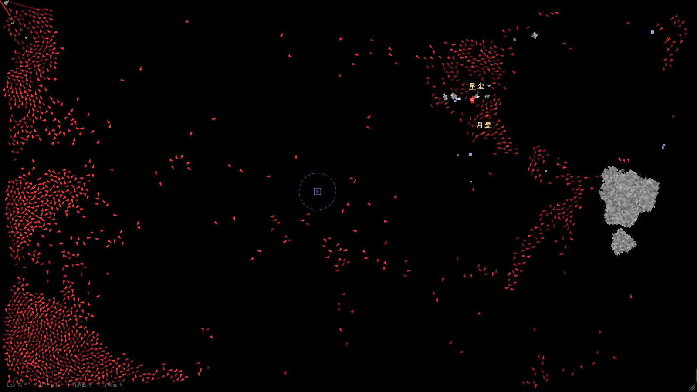
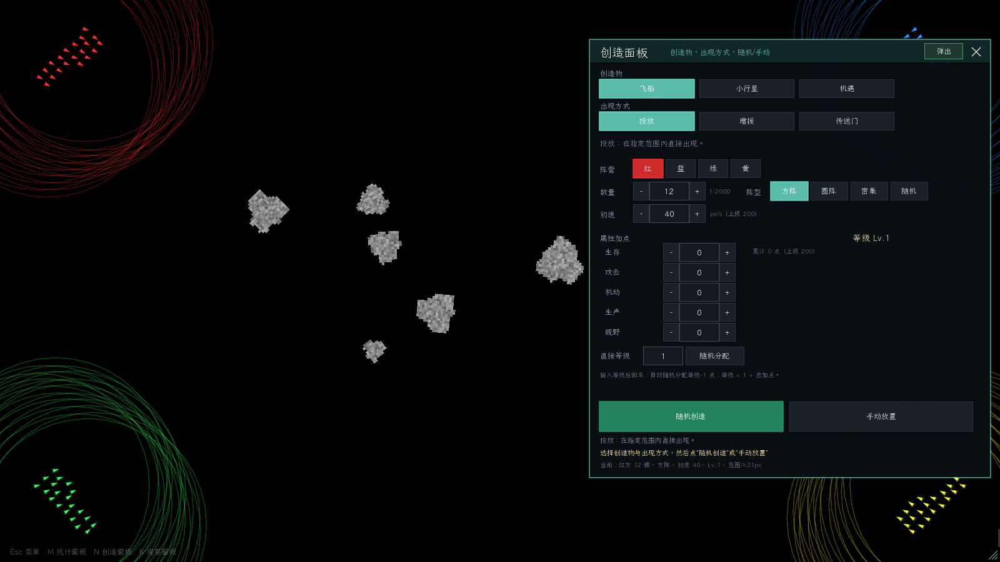
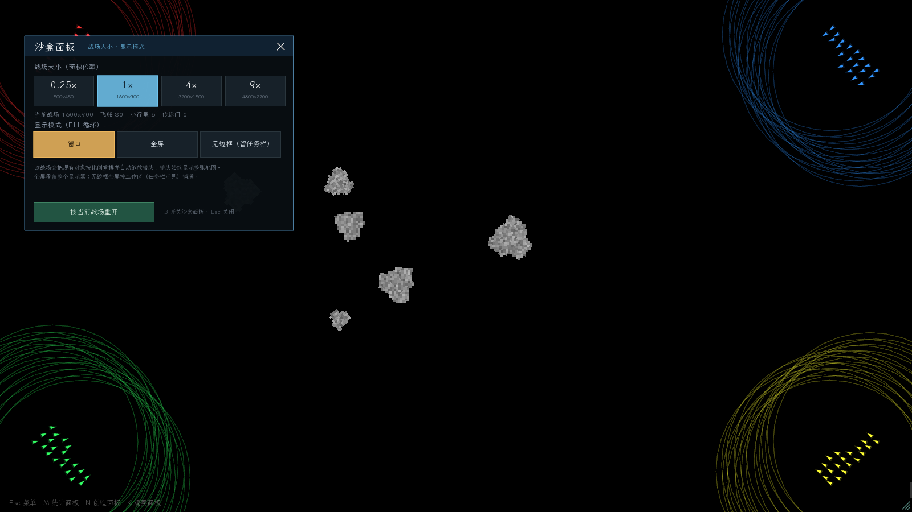

# 暗域光战 / Darkfield Lightwar

**C++17 + SFML 2.6.2 的四人阵营太空战争沙盘。**
舰队自动交战、采矿、建造、抢区域、叛乱换阵营；支持上万艘飞船同屏、创造投放、传送门、统计排行、
观察面板和可缩放的战场。

> 作者 / Author: **Lovichart**  
> 代码许可：MIT · 原创非代码素材：CC BY 4.0  
> 仓库：https://github.com/Lovichart/Darkfield-Lightwar



## 特性

- **万艘同屏**：10,000 艘混战约 57–60 FPS；4,000 艘稳定 60 FPS（i5-10300H / GTX 1650）。
- **创造面板（`N`）**：飞船 / 小行星 / 机遇；投放 / 增援 / 传送门；方阵 / 圆阵 / 密集 / 随机；
  数量、初速、属性加点、小行星大小与不规则度、机遇持续时间/范围/种类；随机或手动放置。
- **传送门**：默认 1000 血（可改到 1,000,000）、固定无碰撞箱、旋转旋涡，每 1/3/5/10 分钟刷一波；
  飞船身份会被敌舰攻击，小行星/机遇身份有各自的颜色与刷波内容。
- **观察面板（`K`）**：视野 / 等级 / 传送门信息 / 称号四个显示开关，支持全开 / 全关。
- **称号**：击杀 ≥ 5 获得称号，在飞船下方实时显示；18 px 粗体图集 + 黑影/黑底，密集编队可读。
- **统计面板（`M`/`H`）**：阵营 25 项、个体 14 项指标；累计 / 近 1/5/10 分钟 / 仅峰值；
  显示淘汰者；可调行数/行宽/格式；排行窗口可弹出为独立桌面窗口。
- **沙盒面板（`B`）**：0.25× / 1× / 4× / 9× 战场（800×450 到 4800×2700），镜头自动缩放到全图；
  窗口 / 全屏 / 无边框全屏（保留任务栏），`F11` 循环。
- **地图缩放（`V` / 右下角手柄）**：不改变战场大小，只缩放显示，仍然能看到全图。
- 中文界面、无外部素材依赖；发布包自带 OFL 字体和 app-local MSVC 运行库。

<div align="center">
  
  
</div>

## 操作

| 键 | 功能 |
|---|---|
| `Esc` | 依次关闭统计 / 创造 / 观察 / 沙盒面板；都不开时显示/隐藏基本 UI |
| `M` / `H` | 统计面板（统计排行） |
| `N` | 创造面板 |
| `K` | 观察面板 |
| `B` | 沙盒面板（战场大小 / 显示模式） |
| `F11` | 窗口 → 全屏 → 无边框全屏（留任务栏）→ 窗口 |
| `V` | 地图全屏 ↔ 900×506 等比缩小；拖右下角手柄自由缩放 |
| `L` | 飞船等级数字 |
| `Tab` | 视野显示模式（6 档，含关闭） |
| `O` | 叛乱系统开关 |
| `C` | 友军碰撞开关（默认开） |
| `F` | 友军伤害开关（默认开） |
| `空格` | 暂停 / 继续 |
| `1` / `2` / `3` / `4` | 0.5× / 1× / 2× / 4× 速度 |
| `F2` | 选中一艘飞船 |
| `F3` | 性能叠加层（FPS、模拟耗时、实体数、种子、战场大小、显示模式） |
| `F5` | 打乱所有舰队位置，立即混战 |
| 左键 | 选中飞船；点空处取消 |
| 右键 | 取消创造面板的手动放置预览 |
| `R` | 重开沙盘 |

## 构建

环境：

- Windows 10/11 x64
- Visual Studio 2022（v143）
- SFML **2.6.2**（默认路径 `H:\SFML-2.6.2`，见下）

```powershell
# 构建 Release x64
powershell -ExecutionPolicy Bypass -File .\build.ps1

# 构建并启动
powershell -ExecutionPolicy Bypass -File .\build.ps1 -Run

# 无窗口基准：总船数 / 秒数
powershell -ExecutionPolicy Bypass -File .\build.ps1 -Bench 10000 -Seconds 8
```

如果 SFML 不在默认路径，用 `SFML_ROOT` 覆盖（推荐）：

```powershell
$env:SFML_ROOT = 'C:\SFML-2.6.2'
powershell -ExecutionPolicy Bypass -File .\build.ps1
```

也可以直接用 VS 打开 `Darkfield Lightwar.sln`，在项目属性里设置 `SFML_ROOT`。

构建输出在 `x64\Release\Darkfield Lightwar.exe`。post-build 会把 SFML DLL、`fonts/`、`names/` 拷到输出目录。

## 下载

从 [Releases](https://github.com/Lovichart/Darkfield-Lightwar/releases) 下载最新 win64 包，解压即玩。
发布包只包含 OFL 字体（霞鹜文楷），不包含 Arial / 微软雅黑等专有字体。

## 玩法摘要

- 四个阵营在战场四角出生，AI 自动寻找敌人、采矿、收集光点、建造子船、抢区域升级。
- 击杀数达到 3 获得拖尾，达到 5 获得称号；阵营被清空后，叛乱系统可能把其他阵营的船拉过来。
- 小行星/彗星会按相对速度伤害飞船；激光会被路径上的飞船、小行星、光点拦截。
- 创造面板可以随时改变战场：投放舰队、增援、传送门；沙盒面板可以把战场放大到 9×。

更完整的规则和开发说明见：

- [游戏说明](Darkfield%20Lightwar/README.md)
- [沙盘说明书](Darkfield%20Lightwar/沙盘说明书.txt)
- [更新日志](Darkfield%20Lightwar/更新日志.md)
- [开发交接](%E4%BA%A4%E6%8E%A5%E6%96%87%E6%A1%A3.md)

## 目录

```text
Darkfield Lightwar.sln
build.ps1                 构建 / 运行 / 基准
package.ps1               维护者打包脚本
Darkfield Lightwar/
  include/ src/           C++17 源码（6 cpp / 5 h）
  fonts/                  发布只带 LXGW WenKai（OFL）
  names/                  阵营/舰名池
  docs/                   截图与开发文档
docs/                     本 README 用截图
licenses/                 SFML / OFL / CC BY 法律文本
```

## 许可与署名

本项目采用**双许可**：

- **代码**（`src/`、`include/`、`build.ps1`、`package.ps1`、工程文件等）：**MIT**，见 [LICENSE](LICENSE)。
- **原创非代码素材**（截图、文档文字、名称池、为本项目制作的 UI 文本/数据等）：**CC BY 4.0**，见 [LICENSE-ASSETS](LICENSE-ASSETS)。

转载/分发时请保留署名，示例：

> “暗域光战 / Darkfield Lightwar” by **Lovichart**,
> https://github.com/Lovichart/Darkfield-Lightwar,
> 代码 MIT，原创素材 CC BY 4.0。

第三方组件不适用上述双许可：

- **SFML 2.6.2**：zlib 许可，见 [licenses/SFML.txt](licenses/SFML.txt)。
- **LXGW WenKai / 霞鹜文楷**：SIL OFL 1.1，见 [licenses/OFL-1.1.txt](licenses/OFL-1.1.txt)。
- **Microsoft Visual C++ 运行库**：按微软可再分发条款随 Release 提供。
- 详见 [THIRD_PARTY_NOTICES.md](THIRD_PARTY_NOTICES.md)。

> 本项目**不包含** Microsoft YaHei、Arial 等专有字体，也不应把它们加入发布包。

## 开发说明

- 主循环固定 60 Hz 步长，速度 0.5×–4×；模拟与渲染解耦。
- 数据导向实体池 + 均匀网格；碰撞 20 Hz；AI 降频 + 环形搜索。
- 渲染批处理：飞船顶点、小行星图集、称号图集、激光/光点/拖尾各自一次 draw。
- 统计层约 10 Hz 快照，环形桶保存最近 10 分钟。
- 战场大小只重排坐标，不缩放飞船/小行星体积和速度；网格按最大 4800×2700 初始化。

性能基线、踩坑和下一步见 [交接文档](%E4%BA%A4%E6%8E%A5%E6%96%87%E6%A1%A3.md)。

---

### English

Darkfield Lightwar is a C++17 / SFML 2.6.2 four-faction space battle sandbox. It supports
up to ~20,000 ships, a creation panel (ships / asteroids / opportunities / portals),
a live stats panel, an observation panel, title labels, and 0.25×–9× battlefields with
windowed / fullscreen / borderless display modes.

- Code: MIT
- Original non-code assets: CC BY 4.0
- Author: Lovichart

Build with Visual Studio 2022 and SFML 2.6.2. Set `SFML_ROOT` if SFML is not at
`H:\SFML-2.6.2`, then run `build.ps1`.
